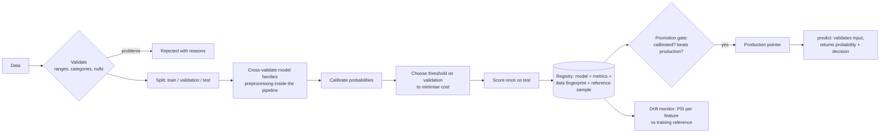

# churn-ml-pipeline

The parts of a machine-learning project that come after `model.fit`: input validation, leak-free training, calibrated probabilities, a decision threshold chosen from business costs, a versioned model registry with a promotion gate, and drift monitoring.

Python 3.10+, scikit-learn, pandas.

## Lifecycle



## Demo run

`python -m churnml` on 6,000 **synthetic** customers. The data is generated from a known formula, which has one real advantage: the score of a perfect model is known, so the result can be judged against a ceiling.

```
Data: 6,000 synthetic customers, churn rate 16.3%
Cross-validated ROC AUC by model family: logistic_regression 0.7776, gradient_boosting 0.7518
Selected: logistic_regression

Held-out test set:
  ROC AUC            0.7905   (a model that knew the true probabilities scores 0.7896)
  PR AUC             0.4274
  Brier score        0.1144
  Calibration error  0.0105

Threshold chosen on validation data to minimise cost (missed churner = 3000, wasted offer = 500):
  threshold 0.18: contact 34.2% of customers, precision 0.33, recall 0.69
  cost per customer: 265 at the chosen threshold, 440 at the default 0.5, 490 if nobody is contacted

Registry: registered v1; promote -> (True, 'promoted v1')
Registry: registered v2 (trained on 300 rows); promote -> (False, 'calibration error 0.090 exceeds 0.05')

Drift check against the training reference:
  same distribution: ok
  after a price rise and a shift to monthly contracts: alert  {'monthly_charge': 3.8853, 'logins_30d': 0.1542, 'contract': 0.3388}
```

How to read it honestly:

- **An AUC of 0.79 is the ceiling here, not a weakness.** Churn in this data is partly random by construction, and even knowing the true probabilities gives 0.79. The model matching it (the tiny excess is sampling noise on 1,200 test rows) says there is nothing left to learn, which you can only know because the data is synthetic.
- **Logistic regression beats gradient boosting** because the generating formula is itself logistic. On real data that would not be a safe assumption, which is why the pipeline compares families instead of picking one.
- **The threshold matters more than the model.** At the default 0.5 the model saves 10% versus doing nothing; at the cost-based threshold it saves 46%. Same model.

## What each part guards against

| Part | Failure it prevents | Test |
|---|---|---|
| `validate` | Training or scoring on out-of-range values, unknown categories or missing columns | `test_validation_names_each_problem` |
| Preprocessing inside the pipeline | Leakage: scaling with statistics from rows the model should not have seen | `test_preprocessing_is_fitted_on_training_data_only` |
| Three-way split | Tuning the threshold on the same data used to report results | threshold is chosen on validation, metrics come from test |
| Calibration | Treating a raw score as a probability | `test_probabilities_are_calibrated` |
| Cost-based threshold | Using 0.5 when a missed churner costs 6x a wasted offer | `test_threshold_follows_the_costs` checks it against the theoretical optimum |
| Registry | "Which model is live, and what was it trained on?" | version, metrics, data fingerprint and reference sample are stored together |
| Promotion gate | A worse or badly calibrated model replacing a good one | `test_promotion_gate_and_rollback` |
| Drift monitor | A model quietly scoring data unlike its training data | `test_drift_report_flags_the_features_that_moved` |

## Use it

```python
from churnml import generate, train, Registry, drift_report

result = train(training_frame, seed=0, cost_fn=3000, cost_fp=500)
registry = Registry("models/")
version = registry.register(result, training_frame, notes="March retrain")
promoted, reason = registry.promote(version, min_auc_gain=0.0)

scores = registry.predict(new_customers)       # churn_probability, contact, model_version
report = drift_report(registry.reference(version), new_customers)
```

```bash
pip install -e ".[dev]"
pytest -q            # 12 tests
python -m churnml
```

## Limits

- **All data is synthetic.** Nothing here says how this would perform on a real customer base, where the signal is messier and labels arrive late.
- **Random split, not time-based.** Real churn models should train on the past and test on the future; the generator has no time dimension.
- **The promotion gate compares metrics measured on each model's own test split.** A fair comparison would score both models on one frozen evaluation set.
- **PSI detects input drift only.** It does not detect the relationship between inputs and churn changing, which needs fresh labels.
- **The registry is a folder.** It has no access control and assumes one writer.
